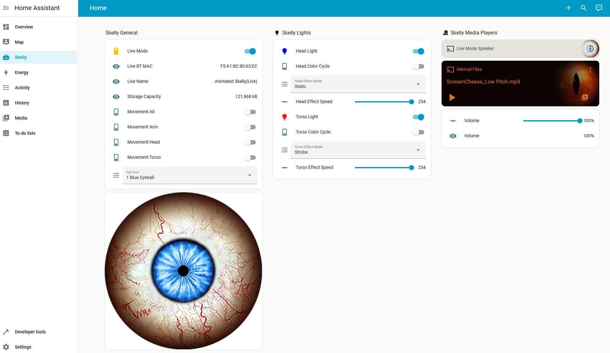

# 💀 Skelly Ultra Integration

Home Assistant integration for the Home Depot 6.5 ft Ultra Skelly and 12 ft Skelly Halloween animatronics and the 7 ft Lethal Lily animatronic witch BLE devices.



See the [Quick Start Guide](QUICK_START.md) or keep reading for detailed instructions.

There is a companion project that provides a fully web browser-based controller here https://github.com/martinecker/SkellyUltraWebController

## 📑 Table of Contents

- [✨ Features](#-features)
- [📋 Prerequisites](#-prerequisites)
  - [🖥️ Skelly Ultra REST Server](#️-skelly-ultra-rest-server)
  - [📡 Live Mode Bluetooth Pairing](#-live-mode-bluetooth-pairing)
- [🔄 BLE Proxy Mode (Alternative Connection Method)](#-ble-proxy-mode-alternative-connection-method)
- [🚀 Installation](#-installation)
- [🎮 Usage](#-usage)
  - [📦 Available Entities](#-available-entities)
  - [🔊 Playing Audio](#-playing-audio)
  - [🤖 Automation Examples](#-automation-examples)
  - [🎭 Perform: Lines with a Matching Mood](#-perform-lines-with-a-matching-mood)
  - [📁 Using the Internal Files Media Player](#-using-the-internal-files-media-player)
  - [🎵 Playing Files Stored on Device (via Services)](#-playing-files-stored-on-device-via-services)
  - [📤 Uploading Audio Files to Device](#-uploading-audio-files-to-device)
- [🛠️ Troubleshooting](#️-troubleshooting)
- [🧪 Running the Tests](#-running-the-tests)
- [📄 License](#-license)

## ✨ Features

Both devices share these features:

- 📊 **Sensor entities**: Volume, live name, storage capacity, file count, file order
- 💡 **Light entities**: RGB lighting control — Torso and Head (Ultra Skelly), Torso (12ft Skelly) or Lantern (Lethal Lily)
- 🔌 **Switch entities**:
  - Live Mode (enables classic Bluetooth speaker)
  - Color Cycle (rainbow effect per light channel)
  - Movement controls — Head/Arm/Torso/All (Ultra Skelly), Head (12ft Skelly) or Wrist/Elbow/Head/Eyes/All (Lethal Lily)
- 🔘 **Button entities**: Trigger Movement (performs one movement using the enabled movement switches), Push Settings to Skelly, Clear Perform History
- 🎚️ **Number entities**: Volume control, effect speed per light channel
- 🎨 **Select entities**: Effect mode per light channel — Static/Strobe/Pulse (Ultra Skelly and 12ft Skelly) or Flickering/Pulsing/Chasing (Lethal Lily)
- 🎵 **Media Player entities**:
  - **Live Mode Speaker**: Play audio to the device's Bluetooth speaker (when Live Mode is enabled)
    - Supports TTS (Text-to-Speech) services
    - Supports multiple audio formats (WAV, MP3, FLAC, OGG, etc.)
  - **Internal Files**: Control playback of audio files stored on the device
    - Browse and play files from device storage
    - Next/previous track controls
    - File metadata available as entity attributes
    - Select files by name
- ⚙️ **Services**: Play/stop individual files stored on the device, enable classic Bluetooth
- 📁 **File management**: Upload files from a path, URL or the media browser (`send_file`) or from any text-to-speech engine (`send_file_from_tts`); change a file's movement, eyes and lights (`edit_file`); choose which files play and in what order (`set_file_order`); delete files; plus a websocket API for a file manager UI
- 🎭 **Perform action**: The device says a literal or AI-written line (optionally reacting to a camera snapshot) with eyes, lights and movement to match a mood, plus a ready-made blueprint

Ultra Skelly only:

- 🎨 **Select entities**: Eye icon selection (18 options)
- 🖼️ **Image entities**: Eye icon preview

## 📋 Prerequisites

### 🖥️ Skelly Ultra REST Server

If you want to use Skelly's live mode and the live mode media player provided by this integration you have to set up and run the Skelly Ultra REST server.

The Skelly Ultra REST server **must be running on a Linux host** (e.g., Raspberry Pi, Ubuntu server, etc.) that can connect to both:
1. Your Home Assistant instance (via network)
2. The Skelly Ultra device via Bluetooth

The REST server handles:
- Classic Bluetooth pairing and connections for Live Mode audio playback
- Audio processing and streaming to the Skelly Ultra speaker

**Important**: The REST server requires `pipewire`, `bluetoothctl`, and related audio tools on the Linux host where it runs.

**Important**: When using a Raspberry Pi to run the server it is *highly* recommended to use a dedicated Bluetooth USB dongle. The built-in Bluetooth controller usually has problems to stream audio to a classic Bluetooth speaker device like the Ultra Skelly, resulting in very choppy playback. I've successfully used the TP-Link UB500 Plus.

For installation and setup of the REST server, see the [REST Server Documentation](custom_components/skelly_ultra/skelly_ultra_srv/README.md).

### 📡 Live Mode Bluetooth Pairing

**Live Mode uses Classic Bluetooth**, which can be paired either automatically (if REST server runs as root) or manually:

#### Option 1: Automatic Pairing (Recommended)

The REST server can automatically pair devices when you enable Live Mode, if it's able to acquire root privileges during the pairing:
See the [REST Server Documentation](custom_components/skelly_ultra/skelly_ultra_srv/README.md) for details.

**How it works**:
1. **Add the integration in Home Assistant** (see Installation section below)
2. **Turn on the "Live Mode" switch** in Home Assistant
   - The integration will automatically discover, pair, and connect to the device
   - Pairing happens seamlessly in the background using the configured PIN
   - The switch should stay on once pairing completes

**That's it!** The pairing persists and you won't need to pair again.

#### Option 2: Manual Pairing

If you prefer not to run the REST server allowing it elevated root privileges for pairing, or automatic pairing fails, you can pair manually:

**Step 1: Make the Bluetooth Speaker Discoverable**

1. **First, add the integration in Home Assistant** (see Installation section below)
2. **Turn on the "Live Mode" switch** in Home Assistant
   - This tells the device to enable its Bluetooth speaker
   - The switch will likely turn off again because pairing hasn't been completed yet - **this is expected**
   - Alternatively, you can call the `skelly_ultra.enable_classic_bt` service

The device will now be discoverable via Bluetooth as `<Device Name>(Live)`. The exact name depends on the BLE device name, unless you manually changed it, and defaults to:

| Device | BLE name (old firmware) | BLE name (current firmware) | Classic BT live name |
|---|---|---|---|
| Ultra Skelly | Animated Skelly | Ultra Skelly v2 | Animated Skelly(Live) or Ultra Skelly v2(Live) |
| 12ft Skelly | — | 12ft Skelly | 12ft Skelly(Live) |
| Lethal Lily | — | Lethal Lily | Lethal Lily(Live) |

**Step 2: Pair Using bluetoothctl**

On the Linux host running the REST server, use `bluetoothctl` to pair with the device:

```bash
bluetoothctl
> scan on
# Wait for your device to appear as "<Your Device Name>(Live)"
> pair <MAC_ADDRESS>
# Enter PIN when prompted (default: 1234)
> trust <MAC_ADDRESS>
> exit
```

**Important notes**:
- Pairing only needs to be done **once per device**. The pairing will persist.
- You must enable Live Mode in HA first (even if it doesn't stay on) to make the speaker discoverable
- Look for the device name with **(Live)** suffix — this is the Classic Bluetooth speaker

## 🔄 BLE Proxy Mode (Alternative Connection Method)

By default, the integration connects directly from your Home Assistant host to the Skelly Ultra device via BLE (Bluetooth Low Energy). However, you can alternatively configure the integration to use the **Skelly Ultra REST server as a BLE proxy**.

### What is BLE Proxy Mode?

In BLE proxy mode:
- The REST server handles the BLE connection to your Skelly Ultra device
- Home Assistant communicates with the REST server via HTTP
- The REST server forwards BLE commands to the device and relays responses back to Home Assistant

### When to Use BLE Proxy Mode

BLE proxy mode is useful when:

- **Your Home Assistant host doesn't have Bluetooth hardware** or doesn't support BLE
- **Your Skelly device is out of range** from your Home Assistant host but within range of your REST server
- **You want to centralize Bluetooth management** on a dedicated Linux host
- **You're already running the REST server** for Live Mode audio and want to simplify your setup

### How to Enable BLE Proxy Mode

When adding the integration in Home Assistant:

1. Go to **Settings** → **Devices & Services** → **Add Integration** → **"Skelly Ultra"**
2. In the configuration form:
   - **Check "Use BLE Proxy"** (enable the checkbox)
   - **Enter REST server URL**: `http://<rest-server-ip>:8765` (e.g., `http://192.168.1.100:8765`)
3. Choose your preferred discovery mode:
   - **Scan**: The REST server will scan for nearby devices
   - **Manual**: Enter the device's MAC address manually

### Important Differences in BLE Proxy Mode

#### Device Identification
- In direct BLE mode, devices are identified by MAC address only
- In BLE proxy mode, devices are identified by **both MAC address and REST server URL**
- Example device title in proxy mode: `Ultra Skelly v2 (AA:BB:CC:DD:EE:FF via http://192.168.1.100:8765)`

#### Scanning Behavior
- In direct BLE mode, scanning uses Home Assistant's Bluetooth integration
- In BLE proxy mode, scanning is performed by the REST server using its BLE adapter
- The REST server maintains a background scan cache and returns results quickly
- Scan timeout is properly utilized to wait for devices to appear

### Prerequisites for BLE Proxy Mode

- **Skelly Ultra REST server** must be installed and running (see [REST Server Documentation](custom_components/skelly_ultra/skelly_ultra_srv/README.md))
- **REST server must be accessible** from your Home Assistant host via HTTP
- **Bluetooth hardware** must be available on the REST server host
- **No Bluetooth integration required** in Home Assistant (BLE proxy mode bypasses it)

### Switching Between Direct and Proxy Mode

If you want to change connection modes:

1. **Remove the existing integration** from Home Assistant
2. **Re-add the integration** with the new settings
3. Choose "Use BLE Proxy" checkbox accordingly

**Note**: You cannot switch modes for an existing config entry - you must remove and re-add the integration.

## 🚀 Installation

### Step 1: Install the Integration Files

Copy the integration files to your Home Assistant configuration directory:

```bash
# Copy to custom_components folder
cp -r skelly_ultra <config_directory>/custom_components/
```

Or use HACS and add https://github.com/martinecker/SkellyUltra as a custom repository, or manually download and extract to `<config>/custom_components/skelly_ultra/`.

### Step 2: Set Up the REST Server

This step is optional but highly recommended and required if you want to use the live mode media player provided by this integration.

If you want to use the live mode audio feature, set up and start the Skelly Ultra REST server on your Linux host. See [skelly_ultra_srv/README.md](custom_components/skelly_ultra/skelly_ultra_srv/README.md) for detailed instructions.

### Step 3: Add the Integration in Home Assistant

1. **Restart Home Assistant** to load the custom component

2. **Add the integration**:
   - Go to **Settings** → **Devices & Services**
   - Click **"+ Add Integration"**
   - Search for **"Skelly Ultra"**

3. **Select your device type** (Step 1 of the config flow):
   - **Ultra Skelly** — the 6.5 ft skeleton (BLE names: "Animated Skelly" on older firmware, "Ultra Skelly v2" on current firmware)
   - **12ft Skelly** — the 12 ft skeleton (BLE name: "12ft Skelly")
   - **Lethal Lily** — the 7 ft animatronic witch (BLE name: "Lethal Lily")

4. **Configure connection settings** (Step 2 of the config flow):
   - Choose connection mode:
     - **Use BLE Proxy**: Check this to use the REST server as a BLE proxy (see [BLE Proxy Mode](#-ble-proxy-mode-alternative-connection-method) section)
     - Leave unchecked for direct BLE connection from Home Assistant host
   - Choose configuration mode:
     - **Scan**: Discover nearby devices automatically (filters for all supported BLE names)
     - **Manual**: Enter the Bluetooth MAC address directly
   - **REST server URL**: URL of the Skelly Ultra REST server (default: `http://localhost:8765`)
     - If the server is on a different host, use `http://<server-ip>:8765`
     - Required for Live Mode audio
     - Required for BLE proxy mode

5. **Verify setup**:
   - The integration should show as "Connected"
   - Entities will be created based on your selected device type

### Step 4: Enable Live Mode for Audio Playback

1. **Ensure Bluetooth pairing is complete** (see Prerequisites above)

2. **Turn on the "Live Mode" switch**:
   - This tells the Skelly device to enable its Classic Bluetooth speaker
   - The REST server will attempt to connect to the speaker

3. **Wait for connection** (may take 10-30 seconds):
   - The Media Player entity will become available once connected
   - Check the Live Mode switch - it should show as "On"

4. **Troubleshoot if needed**:
   - Check Home Assistant logs for error messages
   - Check REST server logs for connection details
   - Verify the device is paired and trusted in `bluetoothctl`

## 🎮 Usage

### 📦 Available Entities

The integration creates different entities depending on which device type you configured.

#### Ultra Skelly

- **Lights**: Torso Light (channel 0), Head Light (channel 1) — RGB with brightness
- **Movement switches**: Head, Arm, Torso, All
- **Effect mode selects**: Torso Effect Mode, Head Effect Mode — Static / Strobe / Pulse
- **Effect speed numbers**: Torso Effect Speed, Head Effect Speed
- **Color cycle switches**: Torso Color Cycle, Head Color Cycle
- **Eye icon select**: 18 eye icon options
- **Eye icon image**: Preview of the currently active eye icon

#### 12ft Skelly

- **Lights**: Torso Light (channel 0) — RGB with brightness
- **Movement switches**: Head
- **Effect mode select**: Torso Effect Mode — Static / Strobe / Pulse
- **Effect speed number**: Torso Effect Speed
- **Color cycle switch**: Torso Color Cycle
- **Eye icon select**: 20 eye icon options (different order than the Ultra Skelly)
- **Eye icon image**: Preview of the currently active eye icon

#### Lethal Lily

- **Lights**: Lantern (channel 0) — RGB with brightness
- **Movement switches**: Wrist, Elbow, Head, Eyes, All
- **Effect mode select**: Lantern Effect Mode — Flickering / Pulsing / Chasing
- **Effect speed number**: Lantern Effect Speed
- **Color cycle switch**: Lantern Color Cycle

#### All devices

- **Media Player - Live Mode Speaker**: Control audio playback when Live Mode is enabled
  - Supports volume control, play/pause, stop
  - Works with TTS (Text-to-Speech) services
  - Supports multiple audio formats (MP3, WAV, FLAC, OGG, M4A, etc.)
  - Audio is sent to the REST server as FLAC, which needs `ffmpeg` on the Home Assistant host (Home Assistant OS and the official container images include it)
- **Media Player - Internal Files**: Play audio files stored on the device's internal storage
  - Browse files via media browser UI
  - Next/previous track navigation
  - Select files by name
  - File metadata exposed as entity attributes (file_index, file_name, file_duration, file_action, file_eye_icon)
  - Shared volume control with device
- **Sensors**: Volume, live name, storage capacity, file count, file order, BT MAC, pin code, file transfer progress
- **Signal strength sensors** (diagnostic): RSSI of the live-mode classic link (in dB relative to the controller's golden receive range, 0 = good) and, in BLE proxy mode, of the BLE link (in dBm). Both are read by the REST server, which needs to run as root or in the privileged Docker container for this. Not available for direct BLE connections, since Home Assistant's Bluetooth stack doesn't report RSSI for connected devices
- **Switches**: Connected (master on/off), Live Mode, Override Chunk Size, Override Bitrate
- **Numbers**: Volume, Override Chunk Size Value
- **Buttons**: Trigger Movement, Push Settings to Skelly (see below), Clear Perform History

**Note about entity IDs**: Entity IDs are generated based on:
1. The BLE device name discovered during config (e.g., "Ultra Skelly v2", "Animated Skelly", or "Lethal Lily")
2. The device's Bluetooth MAC address (to support multiple devices)

For example, if your Lethal Lily's BLE name is "Lethal Lily" with MAC address `AA:BB:CC:DD:EE:FF`, the live mode media player might be:
- `media_player.lethal_lily_aa_bb_cc_dd_ee_ff_live_mode_speaker`

You can find your actual entity IDs in **Settings** → **Devices & Services** → **Skelly Ultra** → click on your device.

### 💡 Keeping the Skelly's Light Settings in Sync

By default the Skelly is in charge of its settings: after a reconnect, Home Assistant shows whatever the device reports, including changes made in the phone app.

After a power-up, though, the Skelly can show a different look than the live settings it reports (for example the lights of its first file) until it receives a setting. Two things help:

- **Push Settings to Skelly** button: sends all live light settings (brightness, effect, effect speed, color and color cycle per light), the eye icon and the volume that Home Assistant shows to the device. Movement is never sent, since that would start a move. Refuses while the device plays a stored file.
- **Home Assistant controls light, eye and volume settings** option (**Settings** → **Devices & Services** → **Skelly Ultra** → **Configure**, off by default): sends the same settings on every connect (Home Assistant start, Connected switch, reconnects), before Home Assistant reads the device (held back until a stored file has finished playing). The settings are the last ones Home Assistant saw, kept across restarts. Changes made in the phone app while Home Assistant is connected are kept once Home Assistant has polled them (every 30 seconds); changes made while it is disconnected are overwritten.

### 🔊 Playing Audio

> **Note**: In all examples below, replace `media_player.skelly_ultra_live_mode_speaker` with your actual media player entity ID (see note above about entity naming).

#### Using Text-to-Speech (TTS)

Make your Skelly speak using any TTS service:

```yaml
service: tts.google_translate_say
target:
  entity_id: media_player.skelly_ultra_live_mode_speaker  # Replace with your actual entity ID
data:
  message: "Happy Halloween! Trick or treat!"
  language: "en"
```

Other TTS services also work:

```yaml
service: tts.cloud_say
target:
  entity_id: media_player.skelly_ultra_live_mode_speaker  # Replace with your actual entity ID
data:
  message: "The front door is open"
```

#### Playing Media from URL

```yaml
service: media_player.play_media
target:
  entity_id: media_player.skelly_ultra_live_mode_speaker
data:
  media_content_type: "music"
  media_content_id: "http://example.com/spooky-sound.mp3"
```

#### Playing Local Files

```yaml
service: media_player.play_media
target:
  entity_id: media_player.skelly_ultra_live_mode_speaker
data:
  media_content_type: "music"
  media_content_id: "media-source://media_source/local/halloween_sounds.mp3"
```

Or using a file path accessible from the Home Assistant container:

```yaml
service: media_player.play_media
target:
  entity_id: media_player.skelly_ultra_live_mode_speaker
data:
  media_content_type: "music"
  media_content_id: "/config/www/sounds/my_audio.wav"
```

### 🤖 Automation Examples

#### Announce When Someone Arrives

```yaml
automation:
  - alias: "Skelly Greets Visitors"
    trigger:
      - platform: state
        entity_id: binary_sensor.front_door
        to: "on"
    action:
      - service: tts.google_translate_say
        target:
          entity_id: media_player.skelly_ultra_live_mode_speaker
        data:
          message: "Welcome! Enter if you dare!"
```

#### Play Spooky Sounds at Sunset

```yaml
automation:
  - alias: "Skelly Sunset Sounds"
    trigger:
      - platform: sun
        event: sunset
    action:
      - service: media_player.play_media
        target:
          entity_id: media_player.skelly_ultra_live_mode_speaker
        data:
          media_content_type: "music"
          media_content_id: "media-source://media_source/local/spooky_ambience.mp3"
```

**Notes**:
- Supported audio formats: MP3, WAV, FLAC, OGG, M4A, and more
- The integration automatically handles connecting the Bluetooth speaker
- Pairing can be done automatically if the REST server can get elevated root privileges and otherwise must be done manually via `bluetoothctl` (only needed once)
- First connection after enabling Live Mode may take 10-30 seconds

### 🎭 Perform: Lines with a Matching Mood

The `skelly_ultra.perform` action makes the device say one line in live mode and sets its eyes, lights and movement to match a mood while it speaks. The line is either a literal `message` or written by an [AI Task](https://www.home-assistant.io/integrations/ai_task/) entity from your `prompt`, which can also look at a camera snapshot. Speech comes from any TTS entity you choose (ElevenLabs, Piper, a cloud voice, ...).

What it does, in order:

1. Turns on Live Mode if it is off (and leaves it on), waiting up to `live_mode_timeout` seconds for the speaker. Meanwhile the AI writes the line.
2. Renders the line with the TTS entity.
3. Applies the mood's eyes and lights and sends the movement.
4. Plays the line and waits until it has finished (with `wait_until_done: false`, the action returns here and the rest runs in the background).
5. Puts the eyes and lights back the way they were (unless `restore: false`).

If a perform is already running on the same device, a second call does nothing and returns `status: busy`.

#### Import the Blueprint

The bundled blueprint handles the *when*: it runs `perform` when any of one or more motion sensors, doorbells or event entities fires (binary sensors and event entities can be mixed), with a cooldown and, if you turn them on, only within active hours. Optionally pick one or more buttons (`input_button` or `button` entities) that make the device perform right away, skipping the trigger, active hours and cooldown. *Movement and restore* exposes the action's `movement`, `restore`, `restore_movement` and `live_mode_timeout` fields with the same defaults. The blueprint calls `perform` with `wait_until_done: false`, so the notification actions run while the device speaks.

Under *Notifications*, add any actions to run as the device starts speaking, such as sending the line to phones. `performance.line`, `performance.mood` and `performance.person_present` are available in their templates:

```yaml
action: notify.adult_phones
data:
  title: Door Skelly Talks
  message: "{{ performance.line }}"
```

[](https://my.home-assistant.io/redirect/blueprint_import/?blueprint_url=https%3A%2F%2Fgithub.com%2Fmartinecker%2FSkellyUltra%2Fblob%2Fmain%2Fblueprints%2Fautomation%2Fskelly_ultra%2Fperform.yaml)

#### Example

```yaml
action: skelly_ultra.perform
data:
  device_id: 1234567890abcdef
  prompt: >-
    You are a cheeky skeleton guarding the front door on Halloween.
    Greet whoever is there in one short sentence.
  camera_entity: camera.front_door
  tts_entity: tts.elevenlabs
response_variable: performance
```

The response has `status` (`ok` or `busy`), `line`, `mood`, `person_present` (only with a camera, `null` otherwise; it is for information and never stops the device from speaking) and `history` (the recent AI lines).

#### Fields

| Field | Description |
|---|---|
| `device_id` / `entity_id` | The device, as for the other actions |
| `message` | A literal line. Skips the AI. Give either `message` or `prompt` |
| `prompt` | Instructions for the AI, sent as is. Keeping lines short and family friendly is up to the prompt |
| `camera_entity` | Optional camera whose snapshot goes with the prompt |
| `camera_wait` | With a camera, seconds to wait for it to publish a new image before it goes to the AI (default 1). Snapshot cameras such as ring-mqtt publish the image of what moved a moment after the motion event; without a new image in time the current one is used. Only helps cameras that update their entity with each new image (such as ring-mqtt); use 0 for others |
| `ai_task_entity` | Optional; defaults to the preferred AI Task entity |
| `tts_entity` | Required TTS entity |
| `tts_options` | Optional TTS options, such as `voice` |
| `mood` | `auto` (the AI picks; default with a prompt), `none` (leave the look alone; default with a message), or a mood name |
| `movement` | `mood` (default, the mood's movement), `none`, or a list of body parts such as `[head, arm]` |
| `restore` | Restore eyes and lights afterwards (default `true`) |
| `restore_movement` | Send the previous movement setting back afterwards (default `false`). This makes the device move once more; when off, the movement switches show the movement perform used |
| `live_mode_timeout` | Seconds to wait for Live Mode (default 30) |
| `wait_until_done` | Return only after the line has finished and the look is restored (default `true`). When `false`, the action returns as soon as the line starts playing, with the same response, so following actions such as notifications run while the device speaks; a second perform stays busy until it ends |

#### Moods

| Mood | Eyes | Lights | Movement |
|---|---|---|---|
| `friendly` | Green Eyeball | Warm white (Ultra Skelly head light green), steady | Subtle |
| `spooky` | Color Spiral | Purple, slow pulse | Full |
| `menacing` | Red Eyeball | Red, fast flashing | Full |
| `playful` | Fireworks | Color cycle, fast pulse | Full |
| `mysterious` | Gray Eyeball | Blue, slow pulse | Subtle |

Subtle movement is the head on the Skelly and head and eyes on Lethal Lily; full movement is all parts (the 12ft Skelly only moves its head). Lethal Lily has no eye icons, so its eyes are left alone.

#### Line History

The last 10 AI lines per device are kept (also across restarts) and added to the prompt with a request not to repeat them. Press the device's **Clear Perform History** button to start fresh. Literal messages aren't recorded.

### 📁 Using the Internal Files Media Player

The **Internal Files** media player entity provides a full playlist interface for audio files stored on the device's internal storage.

#### Features

- **Media Browser**: Browse and select files through Home Assistant's media browser UI
- **Playback Controls**: Play, stop, next track, previous track
- **Source Selection**: Select files by name from a dropdown list
- **Volume Control**: Shared volume control with the device (same as other media players and volume number entity)
- **File Metadata**: Access detailed file information via entity attributes
- **Real-time State Sync**: Automatically tracks device play/pause state from device events

#### Controlling Playback

```yaml
# Play a specific file by selecting it as a source
service: media_player.select_source
target:
  entity_id: media_player.skelly_ultra_internal_files
data:
  source: "Spooky Laugh.mp3"

# Play the selected file
service: media_player.media_play
target:
  entity_id: media_player.skelly_ultra_internal_files

# Skip to next file
service: media_player.media_next_track
target:
  entity_id: media_player.skelly_ultra_internal_files

# Stop playback
service: media_player.media_stop
target:
  entity_id: media_player.skelly_ultra_internal_files
```

#### Using File Metadata in Automations

File metadata is available as entity attributes and can be used in automation conditions and templates:

```yaml
automation:
  - alias: "React to specific file playing"
    trigger:
      - platform: state
        entity_id: media_player.skelly_ultra_internal_files
        to: "playing"
    condition:
      - condition: template
        value_template: "{{ state_attr('media_player.skelly_ultra_internal_files', 'file_name') == 'Spooky Laugh.mp3' }}"
    action:
      - service: light.turn_on
        target:
          entity_id: light.front_porch
        data:
          effect: "flash"

  - alias: "Log file metadata when playing"
    trigger:
      - platform: state
        entity_id: media_player.skelly_ultra_internal_files
        to: "playing"
    action:
      - service: system_log.write
        data:
          message: >
            Playing file {{ state_attr('media_player.skelly_ultra_internal_files', 'file_name') }}
            (index: {{ state_attr('media_player.skelly_ultra_internal_files', 'file_index') }},
            duration: {{ state_attr('media_player.skelly_ultra_internal_files', 'file_duration') }}s)
```

#### Available Metadata Attributes

The media player exposes the following attributes when a file is selected/playing:

- `file_index`: The 1-based index of the file
- `file_name`: The filename
- `file_duration`: Duration in seconds, reported by the device once playback starts (not available until then)
- `file_action`: Associated action/movement setting as a bitfield. Ultra Skelly: bit 0 = head, bit 1 = arm, bit 2 = torso. 12ft Skelly: bit 1 = head. Lethal Lily: bit 0 = wrist, bit 1 = elbow, bit 4 = head, bit 5 = eyes. Value 255 means all parts.
- `file_eye_icon`: Associated eye icon
- `file_cluster`: File cluster information
- `total_files`: Total number of files on device
- `file_order`: Playback order list (same as File Order sensor, something like `[3, 1, 5, 4, 2]`)

### 🎵 Playing Files Stored on Device (via Services)

The Skelly Ultra can store audio files on its internal storage. You can play or stop these files using the integration's services.

#### File Order Sensor

The **File Order** sensor shows the current playback order of files stored on the device as a list, for example: `[1, 2, 3, 4]`. This represents the order in which files will play.

#### Play File Service

Play a specific file from the device's internal storage:

```yaml
service: skelly_ultra.play_file
data:
  device_id: <device_id>  # Optional if you have only one device
  file_index: 1  # File index (1-based, must be ≥ 1)
```

Or using an entity ID instead of device ID:

```yaml
service: skelly_ultra.play_file
data:
  entity_id: sensor.skelly_ultra_volume  # Any entity from the device
  file_index: 2
```

#### Stop File Service

Stop a specific file that's currently playing:

```yaml
service: skelly_ultra.stop_file
data:
  device_id: <device_id>  # Optional if you have only one device
  file_index: 1  # File index (1-based, must be ≥ 1)
```

### 📤 Uploading Audio Files to Device

The integration provides file transfer services to upload audio files to the device's internal storage. Audio files are automatically converted to 8kHz mono MP3 format for compatibility with the device.

#### Send File Service

Upload an audio file to the device. The file will be automatically converted to the required format if needed.

**Supported file sources**:
- **Local file paths**: Full paths to files accessible from the Home Assistant container
- **HTTP/HTTPS URLs**: Download and upload files from the web
- **Home Assistant media files**: Use `/media/<media_dir>/...` paths, the same URLs HA serves them at (for example, `/media/local/my_audio.ogg` is `my_audio.ogg` in your `local` media folder, usually `/media` or `/config/media`)
- **Media source IDs**: Use `media-source://...` IDs, such as `media-source://media_source/local/my_audio.ogg`. This also covers files uploaded through the Media panel. Text-to-speech media source IDs are not supported.

```yaml
# Upload a local file
service: skelly_ultra.send_file
data:
  device_id: <device_id>  # Optional if you have only one device
  file_path: "/config/www/sounds/spooky_laugh.mp3"
  target_filename: "laugh"  # Extension (.mp3) added automatically

# Upload from URL
service: skelly_ultra.send_file
data:
  file_path: "https://example.com/halloween-sound.wav"
  target_filename: "halloween_sound"

# Upload from Home Assistant media folder
service: skelly_ultra.send_file
data:
  file_path: "/media/local/my_audio.ogg"
  target_filename: "my_audio"

# Upload from a media source ID (for example, a file uploaded in the Media panel)
service: skelly_ultra.send_file
data:
  file_path: "media-source://media_source/local/my_audio.ogg"
  target_filename: "my_audio"
```

**Notes**:
- The `.mp3` extension is added automatically to `target_filename`
- Audio is automatically converted to the preferred device format, which is 8kHz mono MP3 format
- Supported input formats: MP3, WAV, FLAC, OGG, M4A, and many others
- Upload progress is displayed in Home Assistant logs
- Large files may take several minutes to upload over BLE
- The service returns the filename and file index on the device (use `response_variable`), so a following `play_file` can play the new file right away; see the example under Send File from TTS below
- `file_path` also accepts text-to-speech media source IDs, such as `media-source://tts/tts.piper?message={{ "Boo!" | urlencode }}&cache=false`, but the Send File from TTS service below is easier to use

#### Send File from TTS Service

Speak a message with any text-to-speech entity (ElevenLabs, OpenAI, Piper, Google, Home Assistant Cloud, ...) and upload the result to the device as a file. The generated audio is not stored in Home Assistant's TTS cache.

```yaml
service: skelly_ultra.send_file_from_tts
data:
  device_id: <device_id>  # Optional if you have only one device
  tts_entity: tts.elevenlabs
  message: "Welcome, mortal. Come closer."
  target_filename: "welcome"  # Optional, .mp3 added automatically
  language: "en"  # Optional
  tts_options:  # Optional, engine-specific (ElevenLabs takes a voice ID)
    voice: "21m00Tcm4TlvDq8ikWAM"
```

The service returns the filename and file index on the device, so an automation can play it right away:

```yaml
- action: skelly_ultra.send_file_from_tts
  data:
    tts_entity: tts.piper
    message: "Happy Halloween!"
  response_variable: upload
- action: skelly_ultra.play_file
  data:
    file_index: "{{ upload.file_index }}"
```

**Notes**:
- `file_index` is empty if the file list couldn't be refreshed after the upload (for example while the device is playing); guard the `play_file` step with a condition like `{{ upload.file_index is not none }}` if that can happen
- Without `target_filename`, the name is built from the message (for example `happy_halloween.mp3`), shortened to fit the device's filename length limit
- An explicit `target_filename` that is too long is rejected, the same as for Send File
- Using a filename that already exists on the device replaces that file and keeps its eye, light and movement settings

#### Cancel File Transfer Service

Cancel an ongoing file upload if it's taking too long or you need to stop it:

```yaml
service: skelly_ultra.cancel_file_transfer
data:
  device_id: <device_id>  # Optional if you have only one device
```

Or using an entity ID:

```yaml
service: skelly_ultra.cancel_file_transfer
data:
  entity_id: sensor.skelly_ultra_volume  # Any entity from the device
```

**Notes**:
- This service only works while a file transfer is in progress
- The device will receive a cancellation command and stop accepting chunks
- Partial uploads are discarded
- After cancellation, you can start a new upload

#### Delete File Service

Delete a file from the device's internal storage:

```yaml
service: skelly_ultra.delete_file
data:
  device_id: <device_id>  # Optional if you have only one device
  filename: "announcement.mp3"
```

**Notes**:
- `filename` must match a file currently on the device — check the **File Order** sensor or the internal files media player to see what's stored
- The service refreshes the device's file list before deleting (to resolve the file) and again afterward to confirm the change
- Deletion is confirmed with the device before the service call returns; an error is raised if the device doesn't confirm within the timeout

#### Edit File Service

Change the movement, eye icon and lights a file uses while it plays. Give the file by `filename`, or by `file_index` and `cluster`. Anything you leave out keeps its current value, and only values that actually change are sent to the device.

```yaml
service: skelly_ultra.edit_file
data:
  device_id: <device_id>  # Optional if you have only one device
  filename: "welcome.mp3"
  movements: [head, arm]  # Replaces the current set; [] turns movement off
  eye_icon: 5  # 1-based, as in the Eye Icon select
  lights:
    - channel: 0  # Torso light
      rgb: [255, 0, 0]
      effect_mode: Pulse  # Mode name or 1-3
      effect_speed: 200  # 0 slowest to 254 fastest, like the Effect Speed entities
    - channel: 1  # Head light
      brightness: 128
      color_cycle: true
```

**Notes**:
- Movement parts depend on the device: Ultra Skelly has `all`, `head`, `arm`, `torso`; 12ft Skelly has `head`; Lethal Lily has `all`, `wrist`, `elbow`, `head`, `eyes`
- Light channels: Ultra Skelly has 0 (torso) and 1 (head); 12ft Skelly and Lethal Lily have 0. Light mode names are Static, Strobe, Pulse (Lethal Lily: Flickering, Pulsing, Chasing)
- Eye icons aren't available on Lethal Lily
- The file list is refreshed before the edit (to find the file) and after it, if anything changed or a write failed partway
- The device must be connected and not playing a file, since the file list can't be read during playback

#### Set File Order Service

Choose which files are enabled for playback and in what order, like the checkboxes and drag-and-drop in the web controller's file list. Files you leave out are disabled. At least one file must be enabled.

```yaml
service: skelly_ultra.set_file_order
data:
  device_id: <device_id>  # Optional if you have only one device
  filenames:  # Or file_indices: [3, 1, 2]
    - greeting.mp3
    - laugh.mp3
response_variable: result  # Optional
```

The optional response holds the play order the device reports afterwards:

```yaml
file_order:
  - file_index: 3
    filename: greeting.mp3
  - file_index: 1
    filename: laugh.mp3
```

**Notes**:
- Give the files by `filenames` or by `file_indices` (as in the file list), not both, and list each file once
- The device must be connected and not playing a file, since the file list can't be read during playback
- The **File Order** sensor is updated with the new order

#### Websocket API for a File Manager UI

For a dashboard card or panel, two websocket commands return everything needed to show and edit the files on a device. They only read; changes go through the actions above (`send_file`, `edit_file`, `set_file_order`, `delete_file`).

- `skelly_ultra/files/list`: returns the payload once. Pass `refresh: true` to read the file list from the device first (skipped while it's disconnected or playing a file).
- `skelly_ultra/files/subscribe`: sends the payload right away and again whenever it changes (file list, play order, free storage, availability, upload progress).

Both take `entry_id` or `device_id`, or neither if you have only one Skelly.

```js
const files = await hass.callWS({ type: "skelly_ultra/files/list", refresh: true });
const unsub = await hass.connection.subscribeMessage(
  (payload) => render(payload),
  { type: "skelly_ultra/files/subscribe" }
);
```

The payload:

```yaml
entry_id: 01J...
unloaded: false
available: true
capacity: {free_kb: 4000, file_count_reported: 3}
file_order: [3, 1]  # file indices of the enabled files, in play order
files:
  - name: hello.mp3
    file_index: 1
    cluster: 1010
    enabled: true
    movements: [head, torso]  # as edit_file takes them
    movement_bits: 5
    eye_icon: 7  # null on Lethal Lily
    lights:  # as edit_file takes them; effect_speed 0 slowest to 254 fastest
      - {channel: 0, brightness: 255, effect_mode: 1, effect_speed: 254, rgb: [255, 0, 0], color_cycle: false}
transfer: {status: uploading, in_progress: true, progress: 42, filename: boo.mp3, error: null}
device_profile:
  type: ultra_skelly
  display_name: Ultra Skelly
  movements: [all, head, arm, torso]
  lights: [{channel: 0, label: Torso Light}, {channel: 1, label: Head Light}]
  light_modes: [Static, Strobe, Pulse]  # effect_mode 1, 2, 3
  eye_icons:  # empty on Lethal Lily
    - {value: 1, label: 1 Blue Eyeball, url: /skelly_ultra/eye_icons/skelly/eye_icon_1.png}
  max_effect_speed: 254
```

`transfer.status` is `idle`, `uploading`, `complete`, `cancelled` or `error`. The device only reports its free storage, not its total size. `movements` lists only the parts the device profile knows; `movement_bits` is the raw value.

When the integration is reloaded or removed, a subscription gets one last event with `unloaded: true` and then ends. Subscribe again to follow the reloaded device.

#### Automation Example: Play Different Files Based on Time

```yaml
automation:
  - alias: "Skelly Morning Greeting"
    trigger:
      - platform: time
        at: "09:00:00"
    action:
      - service: skelly_ultra.play_file
        data:
          file_index: 1  # Play the first stored file

  - alias: "Skelly Evening Sounds"
    trigger:
      - platform: time
        at: "18:00:00"
    action:
      - service: skelly_ultra.play_file
        data:
          file_index: 3  # Play the third stored file
```

**Notes**:
- File indices are 1-based (first file is index 1, not 0)
- The valid range is [1, N] where N is the number of files on the device
- Check the **File Count** sensor to see how many files are stored
- Check the **File Order** sensor to see the playback order
- If you have multiple Skelly devices, specify `device_id` or `entity_id`
- If you have only one device, these parameters can be omitted

## 🛠️ Troubleshooting

### ❌ Media Player Shows "Unavailable"

**Cause**: Live Mode is not enabled or the Bluetooth speaker is not connected.

**Solution**:
1. Turn on the **Live Mode switch** in Home Assistant
2. Wait 10-30 seconds for the connection to establish
3. Check Home Assistant logs for error messages
4. Verify the device is paired and trusted:
   ```bash
   bluetoothctl info <MAC_ADDRESS>
   ```
   - Look for `Paired: yes` and `Trusted: yes`

### ⚠️ "Device is NOT Paired" Error

**Cause**: The Skelly device has not been manually paired via Bluetooth.

**Solution**:
1. Pair the device manually (this only needs to be done once):
   ```bash
   bluetoothctl
   scan on
   # Wait for your device to appear
   pair <MAC_ADDRESS>
   # Enter PIN: 1234
   trust <MAC_ADDRESS>
   exit
   ```
2. Try enabling Live Mode again in Home Assistant

### 🔇 Audio Playback Fails

**Symptom**: Media player accepts commands but no audio plays.

**Solution**:
1. **Check REST server logs** for PipeWire/Bluetooth errors
2. **Verify PipeWire is running** on the REST server host:
   ```bash
   systemctl --user status pipewire pipewire-pulse
   ```
3. **Test audio manually** on the REST server host:
   ```bash
   pw-play /path/to/test.wav
   ```
4. **Check Bluetooth connection** on the REST server host:
   ```bash
   bluetoothctl info <MAC_ADDRESS>
   # Look for "Connected: yes"
   ```

### 🌐 REST Server Connection Fails

**Symptom**: Integration shows "Cannot connect to REST server" or similar error.

**Solution**:
1. **Verify the REST server is running**:
   ```bash
   curl http://localhost:8765/health
   ```
   - Should return `{"status": "ok"}`
2. **Check the REST server URL** in the integration configuration:
   - If on same host: `http://localhost:8765`
   - If on different host: `http://<server-ip>:8765`
3. **Check firewall rules** if the REST server is on a different host

### ⏱️ Bluetooth Connection Takes Too Long

**Symptom**: Live Mode switch takes 30+ seconds to turn on.

**Explanation**: Classic Bluetooth connections can take time, especially on first connect. This is normal behavior.

**Solutions**:
- Be patient and wait for the connection to establish
- Check REST server logs for progress
- If it fails, try disabling and re-enabling Live Mode

### 📡 Troubleshooting BLE Proxy Mode

#### REST Server Unreachable

If you see "Cannot connect to REST server" error:
- Verify the REST server is running: `curl http://<server-ip>:8765/health`
- Check firewall rules on the REST server host
- Ensure the URL is correct (include `http://` and port `:8765`)

#### Device Not Found During Scan

If scanning doesn't find your device:
- Ensure the device is powered on and within range of the REST server's Bluetooth adapter
- Check REST server logs for BLE scanning activity
- Try increasing the scan timeout in the config flow
- Verify the device is advertising (try scanning with `bluetoothctl` on the server)

#### Connection Drops Frequently

If the BLE connection is unstable:
- Check for Bluetooth interference (Wi-Fi, other devices)
- Move the REST server closer to the device
- Check REST server logs for BLE errors
- Consider using a dedicated USB Bluetooth adapter

### 🆘 Still Having Issues?

1. **Check Home Assistant logs**: Settings → System → Logs
2. **Check REST server logs**: See output from the REST server terminal
3. **Verify prerequisites**: Ensure PipeWire, bluetoothctl, and all dependencies are installed on the REST server host
4. **Test manually**: Try connecting and playing audio directly on the REST server host before using Home Assistant

## 🧪 Running the Tests

The tests run the integration in a real Home Assistant against a simulated Skelly, so no device or Bluetooth adapter is needed. With Python 3.13 and ffmpeg (on Windows, inside WSL2):

```bash
python3.13 -m venv .venv
. .venv/bin/activate
pip install -r requirements_test.txt
pytest
```

See [tests/README.md](tests/README.md) for details.

## 📄 License

Released under the [MIT License](LICENSE).

This integration is provided as-is for use with Ultra Skelly, 12ft Skelly and Lethal Lily devices. Use it at your own risk. It might brick your Skelly.

